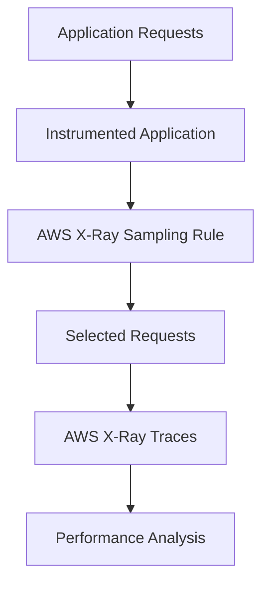

# AWS X-Ray Terraform Lab

## Project Overview

This project demonstrates how to use Terraform and Ubuntu CLI to plan an AWS X-Ray custom sampling rule in `us-east-1`.

**Status: PLAN ONLY — no AWS resources deployed.**

## Architecture



The diagram represents the intended workflow. Only the sampling rule is defined in Terraform. No application or tracing pipeline has been deployed.

## Tools and Services

- AWS X-Ray
- Terraform
- AWS CLI
- Ubuntu Linux
- Git and GitHub

## Planned Resource

| Resource | Configuration | Status |
|---|---|---|
| `aws_xray_sampling_rule.lab` | Custom rule named `terraform-xray-lab-rule` | Planned |

## Sampling Configuration

- Priority: `1000`
- Reservoir size: `1`
- Fixed rate: `0.05` (5%)
- Service name: `terraform-xray-lab`
- HTTP methods: all
- URL paths: all

## Validation

Commands:

```bash
terraform init
terraform fmt
terraform validate
terraform plan -input=false -no-color
```

Verified results:

```text
Success! The configuration is valid.

Plan: 1 to add, 0 to change, 0 to destroy.
```

## Deployment Status

No `terraform apply` was executed.

The sampling rule is planned but not deployed. No application instrumentation or trace collection has been validated.

## Security and Cost

- Terraform state files and local variable files are excluded from Git.
- Do not publish AWS credentials or sensitive trace data.
- AWS X-Ray usage may incur charges when traces are recorded, retrieved, or scanned.

## Future Improvements

- Deploy the sampling rule after authorization.
- Instrument a sample application.
- Generate and inspect traces.
- Analyze application latency and errors.

## Evidence

See `docs/validation-evidence.md` and the screenshot in `screenshots/`.

